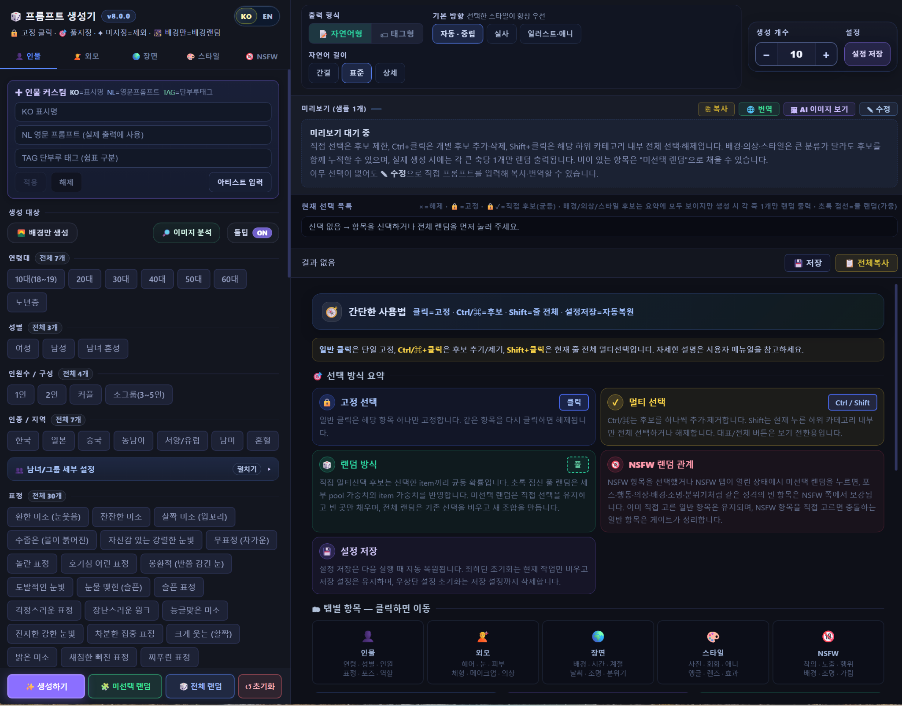
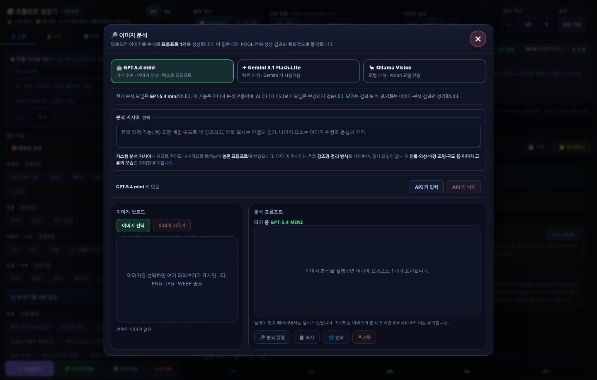
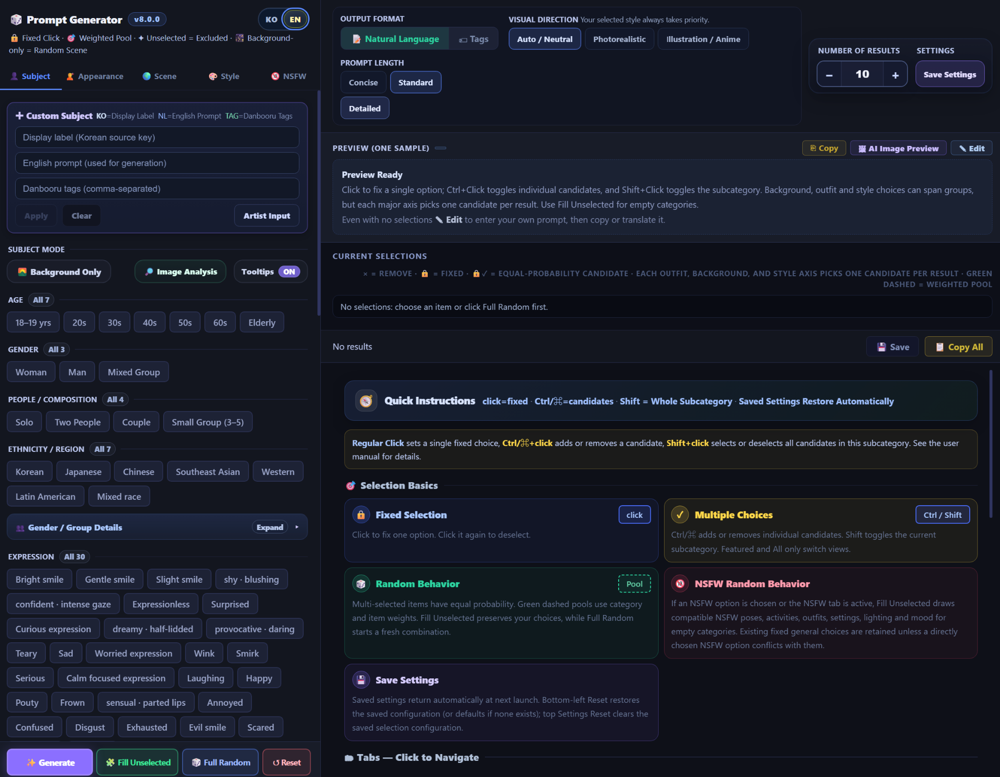
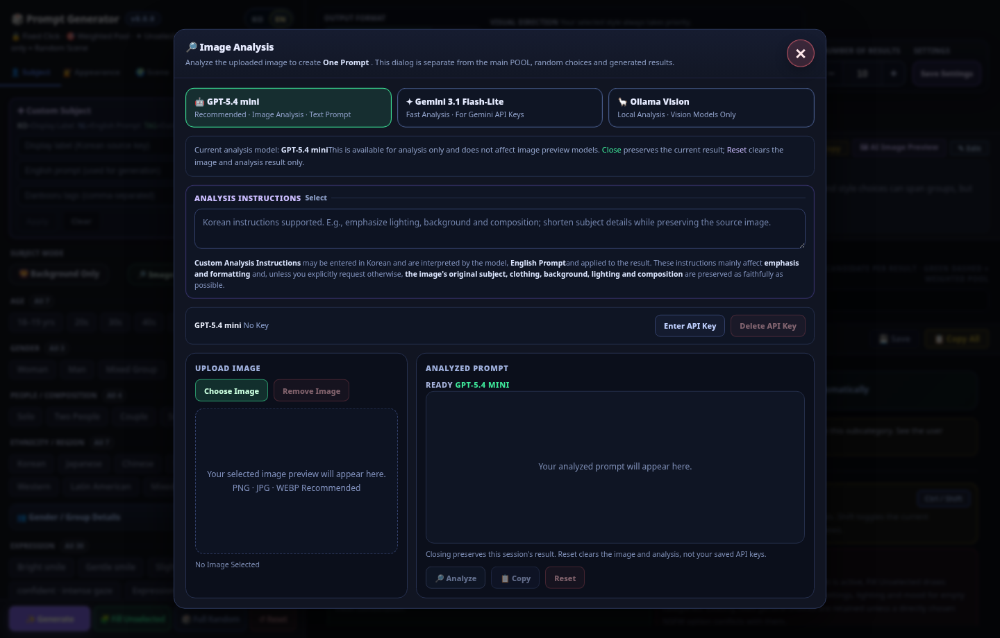

# 🎲 Ultra Random Prompt v8.0.1

**한국어 / English** · **One HTML file** · **ComfyUI & other image-generation workflows**

> 이미지 생성용 영문 프롬프트를 빠르게 구성하고, 여러 후보를 조합하며, 참고 이미지를 분석하여 영어 프롬프트로 변환할 수 있는 브라우저 기반 도구입니다.  
> A bilingual, browser-based prompt composer for a wide range of image-generation workflows, with optional image-to-prompt analysis.

[🇰🇷 한국어](#-한국어) · [🇬🇧 English](#-english) · [Releases](https://github.com/Yamoon-jjang/Ultra-Random-Prompt/releases)

### 🆕 v8.0.1

- 장면 일관성 개선: 배경·이벤트·시간대·조명·계절의 명백한 모순을 자동값에서만 보정합니다. 직접 고정한 선택은 그대로 유지됩니다.
- 조명 다양성 개선: 일반·NSFW 조명이 한 종류로 몰리지 않고 장면에 맞는 여러 후보에서 선택됩니다.
- 이벤트를 고정하면 활성화한 배경 POOL 안에서 어울리는 장소를 고릅니다.
- 복사 버튼 라벨 고정, TXT 파일명 시각(현지 시간), 저장 설정 보존, 커스텀 적용 안내, EN 화면 번역 누락을 수정했습니다.
- Scene coherence: clear contradictions between background, event, time, lighting, and season are reconciled for automatic choices only; explicit selections are preserved.
- Lighting variety: ordinary and adult lighting no longer collapse to a single default.
- A fixed event now steers a random background toward compatible venues within the enabled pool.
- Fixes for the copy-button label, local-time TXT filenames, saved-settings retention, custom-input notice, and missing EN UI strings.

---

## 🇰🇷 한국어

**Ultra Random Prompt**는 여러 ComfyUI 이미지 생성 모델과 기타 이미지 생성 도구에서 활용할 **영어 프롬프트**를 구성하는 독립형 HTML 앱입니다. 프로그램 설치나 ComfyUI 실행 없이 브라우저에서 사용할 수 있으며, **한글/영문 UI를 즉시 전환**할 수 있습니다. 기본 `생성하기` 버튼은 이미지를 생성하지 않고 **프롬프트 텍스트**를 생성합니다.

### 📸 한글 UI

### ✨ 주요 기능

- **5개 구성 탭:** 인물, 외모, 장면, 스타일, 성인 NSFW 항목을 선택하고 조합
- **36개 프리셋:** 사진·실사, 애니·회화, 판타지·SF, 풍경 및 성인 테마의 빠른 시작
- **다양한 선택 방식:** 일반 클릭은 고정, `Ctrl`/`⌘`+클릭은 후보 추가·해제, `Shift`+클릭은 하위 카테고리 멀티 선택
- **다양한 랜덤 조합:** 사용자 선택 유지 후 빈 항목 채우기 / 전체 랜덤 / 가중치 POOL
- **출력 설정:** 자연어형 또는 태그형, 자동·중립/실사/일러스트·애니, 자연어 길이 간결·표준·상세
- **한 번에 1~100개 생성:** 다양성을 고려한 조합, 결과 복사 및 TXT 저장
- **추가 도구:** 프롬프트 직접 수정·번역, 커스텀 항목, 아티스트 참고, 설정 저장·복원
- **선택적 AI 기능:** 참고 이미지 분석과 AI 이미지 미리보기(별도 API 또는 로컬 Vision 모델 필요)

### 🔎 참고 이미지 분석 → 영어 프롬프트

이미지를 업로드하여 이미지에 보이는 **피사체·의상·배경·조명·구도·스타일** 등을 영어 프롬프트 1개로 정리할 수 있습니다. 원하는 분석 방향을 **한글 지시어**로 입력할 수도 있습니다. **메인 랜덤 프롬프트 생성과 독립된 창**에서 작동하며, 분석 결과를 복사하거나 번역할 수 있습니다.

**지원 방식:** OpenAI Vision 기반 분석, Gemini 이미지 분석, 로컬 **Ollama Vision**. 해당 공급자 API 키나 실행 중인 Vision 지원 Ollama 모델이 필요합니다. 이미지 분석은 선택 사항이며, 실제 호출 가능 모델·비용·할당량은 제공사 설정에 따라 달라집니다.

사용 순서: `🔎 이미지 분석` → 분석 모델 선택 → 이미지 업로드 → 필요시 분석 지시어 입력 → `분석 실행` → 생성된 영어 프롬프트 확인·복사.

### 🚀 설치 및 사용

1. [Releases](https://github.com/Yamoon-jjang/Ultra-Random-Prompt/releases)에서 `Ultra_random_prompt_v8.0.1_verified_release.zip`을 받습니다.
2. 압축을 풀고 **`Ultra_random_prompt_v8.0.1.html`**을 Chrome, Edge 등 브라우저에서 엽니다.
3. 좌측에서 원하는 항목을 선택하거나 전체 랜덤을 실행합니다.
4. 출력 형식·방향·길이·생성 개수를 선택한 후 `✨ 생성하기`를 누릅니다.
5. 결과를 복사하거나 TXT로 저장하여 ComfyUI 등의 프롬프트 입력에 붙여 넣습니다.

**설명서:** [`한글 상세 사용자 메뉴얼`](Ultra_random_prompt_v8.0.1_사용자메뉴얼_KO.txt) · [`English User Manual`](Ultra_random_prompt_v8.0.1_User_Manual_EN.txt)

**주의:** 생성 버튼의 기본 결과는 이미지가 아닌 텍스트입니다. 선택적 AI 이미지 미리보기는 OpenAI/Gemini API를 사용하며 비용이 발생할 수 있습니다. API 키가 들어간 HTML 파일을 공개 공유하지 마세요. 저장한 키는 브라우저 localStorage에 보관될 수 있으므로 공용 컴퓨터에서는 주의하세요. 로컬 Ollama 연결은 브라우저 보안·CORS 설정의 영향을 받을 수 있습니다.

---

## 🇬🇧 English

**Ultra Random Prompt** is a standalone, bilingual HTML application for composing **English image-generation prompts** for ComfyUI and other image-model workflows. Open it in a modern browser—no installation or running ComfyUI instance is required for the main prompt composer. Switch between Korean and English without changing the underlying prompt output.

The main **Generate** button creates **prompt text**, not an image.

### 📸 English UI

### ✨ Key features

- **Five creative categories:** Subject, Appearance, Scene, Style, and adult NSFW prompt options
- **36 ready-to-use presets:** Portraits, photography, fashion, anime, painting, fantasy, sci-fi, backgrounds, and adult themes
- **Precise selection controls:** Click to fix a choice; `Ctrl`/`⌘`+click to build candidate sets; `Shift`+click for subcategory-wide selection
- **Controlled randomness:** Fill unselected slots, start an entirely new random combination, or use weighted candidate pools
- **Flexible output:** Natural Language or Tags; Auto/Neutral, Photorealistic, or Illustration/Anime; Concise, Standard, or Detailed natural-language length
- **Batch generation:** Generate 1–100 prompt results with variation and duplicate-reduction safeguards
- **Editing and export:** Edit generated text, copy, translate, export TXT, save settings, and add custom prompt items
- **Optional AI tools:** Image-to-prompt analysis and AI image previews through supported providers

### 🔎 Image Analysis — turn reference images into English prompts

Upload a reference image and use visual analysis to describe its **subject, clothing, environment, lighting, framing, and style** as one English-language prompt. You can add **custom guidance in Korean**, and the analysis window stays separate from the main prompt randomization and results. Copy or translate the extracted prompt as needed.

**Available analysis providers:** OpenAI, Gemini, and local **Ollama Vision**. OpenAI/Gemini require appropriate API access; Ollama requires a running local service and an installed vision-capable model. Provider availability, quotas, latency, and charges may vary. This feature is optional; the core prompt composer works without these services.

Workflow: Click **Image Analysis** → choose a provider/model → upload an image → optionally add instructions → click **Analyze** → review and copy the generated prompt.

### 🚀 Quick start

1. Download `Ultra_random_prompt_v8.0.1_verified_release.zip` from [Releases](https://github.com/Yamoon-jjang/Ultra-Random-Prompt/releases).
2. Extract the archive and open **`Ultra_random_prompt_v8.0.1.html`** in a modern desktop or mobile browser.
3. Select ingredients in the left panel, or choose **Full Random** for a fresh composition.
4. Configure output format, visual direction, prompt length, and number of results.
5. Click **Generate**, then copy or export the prompts for your preferred image-generation workflow.

**Full documentation:** [`English User Manual`](Ultra_random_prompt_v8.0.1_User_Manual_EN.txt) · [`한글 메뉴얼`](Ultra_random_prompt_v8.0.1_사용자메뉴얼_KO.txt)

**Important:** This app primarily generates prompt text, not images. Optional AI Image Preview requests use OpenAI/Gemini services and may incur fees. Do not distribute copies of the HTML with API keys embedded. Saved provider keys may reside in your browser's localStorage; avoid saving them on shared computers. Local Ollama access can depend on browser CORS and local-network rules.

---

### 📦 Files / 배포 파일

| File | Purpose |
|---|---|
| `Ultra_random_prompt_v8.0.1.html` | Standalone HTML app / 단일 HTML 앱 |
| `Ultra_random_prompt_v8.0.1_사용자메뉴얼_KO.txt` | Korean detailed guide / 한글 상세 메뉴얼 |
| `Ultra_random_prompt_v8.0.1_User_Manual_EN.txt` | English detailed guide / 영문 상세 메뉴얼 |
| `README_KO_EN.txt` | Bilingual text overview / 한·영 텍스트 소개 |
| `SHA256SUMS.txt` | File integrity checksums / 파일 무결성 체크섬 |
| `assets/` | KO/EN and image-analysis screenshots / 한·영 및 이미지 분석 화면 |

**Author:** Yamoon-jjang · **Version:** v8.0.1
